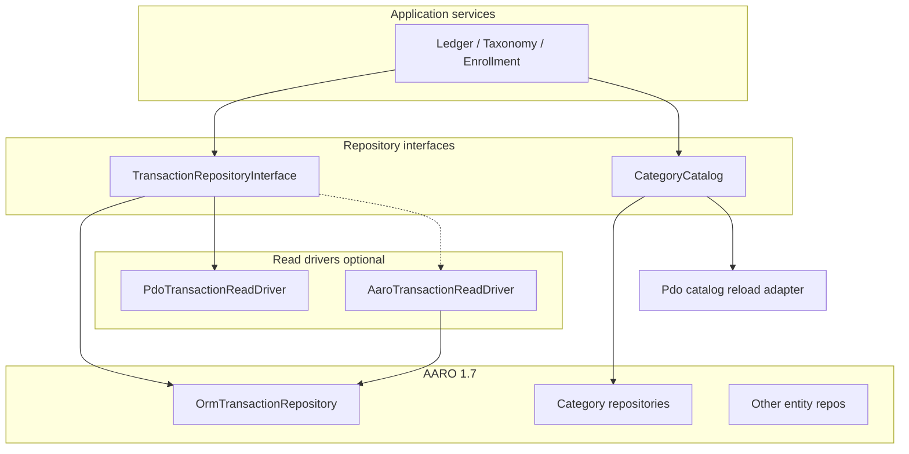

# AARO migration plan — restore repository pattern without blind PDO cutover

**Goal:** MariaDB domain code talks to **repository interfaces** and AARO 1.7 implementations. Direct PDO remains allowed **behind drivers** until microbenchmarks prove AARO parity on hot paths.

**Related:** [aaro-1.7-performance-review.md](aaro-1.7-performance-review.md), [aaro-pdo-migration-checklist.md](aaro-pdo-migration-checklist.md), benchmark harness `bin/benchmark-aaro-reads.php`.

**Run benchmark:** `.env` with migrated MariaDB (dev or `denarius_test`), then  
`composer benchmark:aaro-reads -- --kingdom-id=1 --seed=5000 --iterations=7`.  
Purges only rows matching `bench-aaro-*`. Use `--purge-only` to clean up.

**Read driver toggle:** `TRANSACTION_READ_DRIVER=aaro` selects `AaroTransactionReadDriver`; default (unset or any other value) keeps `PdoTransactionReadDriver`.

## PDO allowlist (never migrate to AARO)

| Area | Examples | Reason |
|------|----------|--------|
| SQLite method logs | `src/Utilities/Log/Sqlite/*` | Separate store, not MariaDB ORM |
| Phinx | `Phinx*MigrationStore`, migration `execute()` | Migrations must not depend on app EntityManager |
| Ops / test harness | `bin/purge-phpunit-fixtures.php`, `tests/Integration/seed.php`, `PersistenceStoreArrange` | Infrastructure |

## MariaDB runtime PDO today

| Component | Role | Target state |
|-----------|------|--------------|
| `PdoTransactionReadDriver` | Kingdom transaction list + lookup | Keep until **A3 benchmark** passes; then optional `AaroTransactionReadDriver` + toggle |
| `DbCategoryCatalog` | Full-table reload + writes | **A2:** writes via AARO repos; **reload** may stay PDO loader behind interface |
| `BankConnectionReset` | Kingdom-scoped DELETE on disconnect | **A1:** repository deletes (AARO) |
| `TransactionRepository` | Facade reads→driver, writes→ORM | Unchanged shape; swap read driver after A3 |

All other `src/Persistence/Repository/*` implementations are already AARO 1.7.

## Cutover policy

1. **No removal** of `PdoTransactionReadDriver` or catalog bulk reload PDO until benchmark results are recorded in `docs/planning/aaro-pdo-migration-benchmarks.md` and meet thresholds below.
2. **New persistence** uses AARO + interfaces; exceptions need a line in this doc.
3. **Orchestrator milestones** that touch transaction reads or catalog reload run `composer benchmark:aaro-reads` before merge (see branch-orchestrator skill).

### Benchmark thresholds (initial)

| Scenario | PDO baseline | AARO candidate | Cutover when |
|----------|--------------|----------------|--------------|
| `listForKingdom` (N rows) | ms median / p95 | ms median / p95 | AARO p95 ≤ **1.25×** PDO p95 at N ∈ {500, 5000, 20000} |
| `findByTellerTransactionId` | ms median | ms median | AARO median ≤ **1.5×** PDO |
| Category catalog reload | ms median | ms median (AARO full scan) | Optional; default **keep PDO reload** unless AARO ≤ 1.1× |

N and iteration counts are configured in the benchmark CLI (`--seed`, `--iterations`).

## Phased milestones (stacked branches)

| Id | Branch (suggested) | Scope | PDO removed? |
|----|----------------------|-------|--------------|
| **A0** | `stack/aaro-migration-plan` | This plan + checklist + orchestrator benchmark step | — |
| **A1** | `stack/aaro-bank-reset-repos` | `BankConnectionReset` → repository APIs | Yes (disconnect path) |
| **A2** | `stack/aaro-category-repos` | AARO repos for `categories` / `category_lineages`; catalog mutations | Writes only; reload TBD |
| **A3** | `stack/aaro-transaction-read-driver` | `AaroTransactionReadDriver` + env toggle | Parallel; PDO default |
| **A4** | `stack/aaro-transaction-read-cutover` | Flip default to AARO reads after benchmarks | PDO driver deleted only if A3 green |

Each implementation milestone: unit suite, mutation gate, logging tests, **benchmark step** (record or re-verify).

## Architecture (target)

## Risks

- **Publication month scans** — highest row counts; benchmark must use realistic N.
- **Boot-time catalog reload** — full table read; do not block app boot on ORM unless measured.
- **Double fetch in `markPublished`** — orthogonal; optimize later if traced hot.
